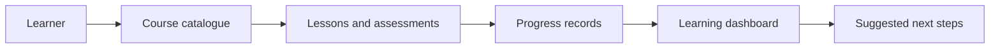

# Conceptual learning architecture

The original documentation describes a membership learning platform, browser-based deterministic task specialists, coding labs and learning pathways. This is a conceptual overview, not private production topology. Payment, identity, premium curriculum and learner data are excluded. The platform is not an accredited university.
